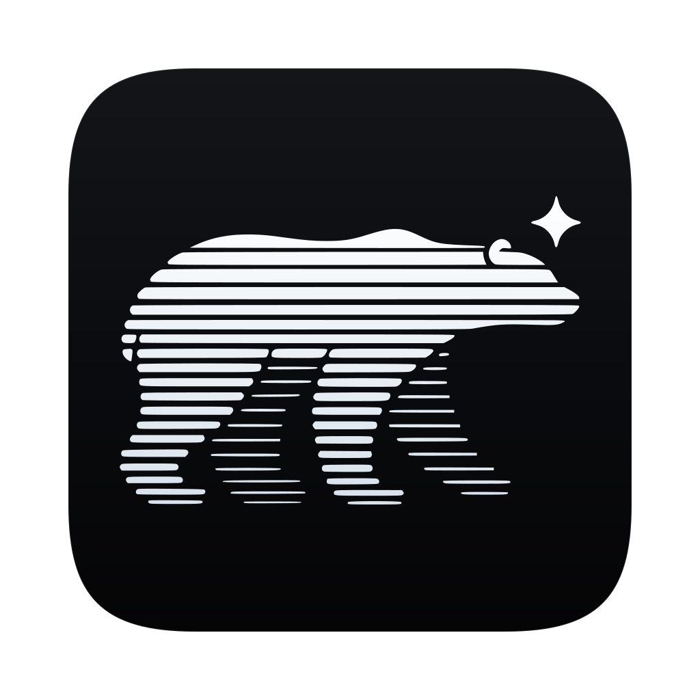

<p align="center"></p>

# Polaris

Fast, lightweight workspace file explorer built with SolidJS, Electron, and a native Zig sidecar.

## Prerequisites

- [Bun](https://bun.sh) (v1.2+)
- [Zig](https://ziglang.org) (v0.17.0)

## Getting Started

```bash
# Install dependencies
bun install

# Start development server
bun run dev

# Run native Zig core tests
bun run core:test

# Typecheck and lint
bun run check

# Production build
bun run build
```

## Testing builds

Invited testers on Arch: see [TESTING.md](TESTING.md).

## Where to change things

The [code map](.docs/code-map.md) points to feature owners, process boundaries and relevant checks.

## License

Polaris is free software, licensed under the
[GNU General Public License v3.0 or later](LICENSE).
